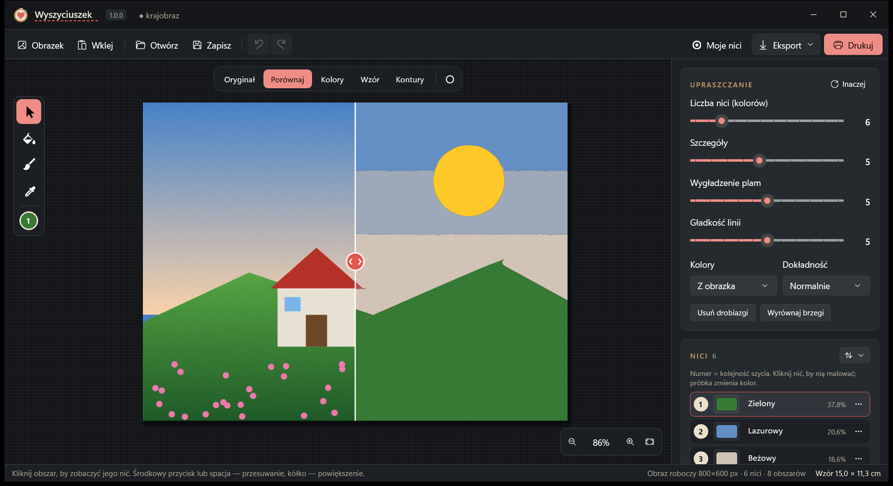

# Wyszyciuszek

**Z dowolnego obrazka — wzór do haftu maszynowego z wolnej ręki.**

Wrzucasz zdjęcie albo rysunek z za dużą liczbą kolorów i szczegółów, a Wyszyciuszek upraszcza go do kilku
kolorów nici i gładkich konturów. Wynik poprawiasz pędzlem i wiaderkiem, ustawiasz rozmiar na tkaninie
i drukujesz w skali 1:1 — z numerami nici w każdym obszarze, jak w kolorowance „malowanie po numerach”.
Potem już tylko przerysowujesz wzór na tkaninę i szyjesz.

Program dla Windows 10/11, napisany w .NET 10 (Native AOT) i WinUI 3, z płótnem Win2D.



## Co potrafi

**Upraszczanie**
- dobór kilku kolorów (2–24) w przestrzeni L\*a\*b\* — tak, jak różnice kolorów widzi oko,
- wygładzanie zdjęcia z zachowaniem krawędzi (znika faktura i szum, granice plam zostają ostre),
- usuwanie drobnych plamek i cienkich pasków, których nie da się wyszyć,
- gładkie kontury (krzywe Béziera) wspólne dla sąsiednich obszarów — bez szczelin i podwójnych linii,
- **„Moje nici”**: wpisz nici, które masz w pudełku, a wzór użyje tylko ich (dopasowanie CIEDE2000);
  pudełko zapiszesz i wczytasz z pliku CSV (Excel), a przy każdej nici wpiszesz, ile metrów zostało na szpulce,
- **„Tło to tkanina”** (do włączenia): kolor dominujący na brzegach obrazka od razu oznaczony jako tkanina — bez numeru i szycia.

**Projektowanie**
- wiaderko — klik w obszar nadaje mu inną nić (sąsiednie obszary tego koloru się łączą),
- pędzel — domalowanie albo zamalowanie fragmentu, pipeta (też pod prawym przyciskiem myszy),
- zmiana koloru i nazwy nici, łączenie kolorów, kolor „tkanina — nie szyję”,
- **kolejność szycia od spodu do wierzchu** — najpierw tło i szerokie plamy, potem to, co na nich leży, na końcu
  cienkie kreski (albo od największych plam, albo od najjaśniejszych),
- **za wąskie na wypełnienie** — obszary węższe niż 3 mm zaznaczone na czerwono, wąskie paski jednym kliknięciem
  zamienione na linie detali (Shift+L — zaznaczony obszar),
- widoki: oryginał, porównanie przed/po z suwakiem, kolory nici, wzór do druku, kontury na oryginale,
- **linie detali** — oczy, wąsy, łodyżki jako samo przeszycie wybraną nicią, bez nowego obszaru (Shift — prosta),
- **kierunek ściegu** — strzałki w obszarach dobierane automatycznie, zmieniane przeciągnięciem myszą,
- pełne cofanie i ponawianie (także ponownego uproszczenia — ręczne poprawki da się odzyskać),
- **kolor tkaniny** — gotowe materiały (biel, len, jeans, czerń…) albo własny kolor; podgląd pokazuje nici na tym
  tle i ostrzega przed nićmi, które się z nim zlewają,
- **lupa** (Z) przy kursorze i **minimapa** całości po przybliżeniu — do drobnych poprawek,
- **autozapis** co minutę — po awarii albo zaniku prądu program proponuje przywrócenie niezapisanej pracy.

**Wydruk**
- skala 1:1 z kwadratem kontrolnym 1 cm, rozmiar w centymetrach albo „dopasuj do tamborka”,
- duże wzory dzielone na kartki A4/A3 z zakładkami, krzyżykami do nakładania i opisem sąsiednich kartek,
- lustrzane odbicie do pisaków i ołówków termotransferowych,
- **linie do kalkowania** — kontury ciągłe, przerywane albo z kropek, czarne albo szare,
- **kalibracja drukarki** — strona testowa z miarkami 100 mm; zmierzona korekta skali przy każdym wydruku (i w PDF),
- numery nici, lekkie podbarwienie kolorem nici, znaczniki środka do wyśrodkowania w tamborku,
- czerwone strzałki kierunku wypełnienia i linie detali kreską-kropką z numerem nici,
- legenda: nici w kolejności szycia (tkanina nie zabiera numeru), próbki kolorów, powierzchnia, orientacyjne zużycie
  nici i czas szycia (dla gęstego, średniego albo szkicowego wypełnienia), ostrzeżenie, gdy nici na szpulce
  zabraknie, miniatura w kolorach na tle tkaniny.

**Projektor**
- wzór na pełnym ekranie w skali 1:1 — z projektora prosto na tkaninę albo z ekranu użytego jak podświetlana szyba,
- kalibracja linijką (raz na każdy ekran), obrót, lustro, przesuwanie, wyróżnienie obszarów jednej nici,
- odhaczanie odrysowanych obszarów kliknięciem i siatka co 1 cm.

**Pliki**
- druk bezpośrednio na drukarkę, wektorowy **PDF**, **PNG** (wzór albo podgląd w kolorach),
- **SVG** z osobną warstwą dla każdej nici (Inkscape, Ink/Stitch, plotery),
- projekt **.wyszycie** (oryginał + wszystkie poprawki), otwierany dwuklikiem.

## Jak zrobić wzór

1. **Obrazek** — otwórz plik (PNG, JPG, BMP, GIF, TIFF, WEBP), przeciągnij go na okno albo wklej ze schowka (Ctrl+V).
2. **Upraszczanie** — ustaw liczbę nici i szczegóły. Mało szczegółów = duże plamy, łatwe do wyszycia.
   Przycisk **Inaczej** dobiera kolory jeszcze raz.
3. **Poprawki** — wiaderkiem (G) zmień nić całego obszaru, pędzlem (B) popraw kształty.
   Kliknięcie nici na liście wybiera ją do malowania, próbka obok zmienia jej kolor.
4. **Wydruk** — wpisz szerokość w centymetrach albo wybierz tamborek i kliknij dopasowanie.
   Widok **Wzór** pokazuje dokładnie to, co wyjdzie z drukarki.
   Linią (L) dorysuj detale do przeszycia, a narzędziem kierunku (D) popraw strzałki tam, gdzie chcesz szyć inaczej.
5. **Drukuj** (Ctrl+P) albo zapisz PDF. Sprawdź kwadrat 1 cm na kartce — drukuj w skali 100%.
   Zamiast drukowania możesz włączyć **Projektor** (F5) i odrysować wzór prosto z ekranu albo projektora.
6. Przenieś wzór na tkaninę (kalka, szyba z lampką, pisak znikający, termotransfer z odbiciem lustrzanym)
   i szyj nićmi w kolejności numerów.

## Skróty klawiszowe

| Klawisz | Działanie |
| --- | --- |
| Ctrl+O / Ctrl+Shift+O | otwórz obrazek / projekt |
| Ctrl+V | wklej obrazek ze schowka |
| Ctrl+S / Ctrl+Shift+S | zapisz projekt / zapisz jako |
| Ctrl+Z / Ctrl+Y | cofnij / ponów |
| Ctrl+P | drukuj |
| V, G, B, I | zaznaczanie, wiaderko, pędzel, pipeta |
| L, D | linia detalu, kierunek ściegu |
| Shift+L | zaznaczony obszar → linia detalu |
| Z | lupa przy kursorze |
| Delete | usuń zaznaczoną linię detalu |
| F5 | tryb projektora |
| [ ] | mniejszy / większy pędzel |
| 1 – 5 | oryginał, porównanie, kolory, wzór, kontury |
| kółko myszy, + − | powiększenie |
| środkowy przycisk albo spacja + przeciąganie | przesuwanie widoku |
| F, Ctrl+0 | dopasuj do okna |
| prawy przycisk myszy | pipeta w każdym narzędziu |

W trybie projektora: **C** kalibracja, **strzałki** przesuwanie (z Shift o 1 mm), **R** obrót, **M** lustro,
**I** jasne/ciemne tło, **N** numery, **K** kierunki ściegu, **G** siatka 1 cm, **Tab** wyróżnienie kolejnej nici,
**0** środek, **klik w obszar** odhacza go (**Delete** czyści odhaczenia), **S** następny ekran, **Esc** wyjście.

## Instalacja i odinstalowanie

Z [wydań](../../releases) pobierz **Wyszyciuszek.exe** i uruchom — to jeden plik, bez instalatora.
Przy pierwszym uruchomieniu program rozpakowuje się do `%LOCALAPPDATA%\Wyszyciuszek\app`, a obok exe kładzie
skrypt **Wyszyciuszek - odinstaluj.cmd**, który usuwa rozpakowane pliki i skojarzenie `.wyszycie`
(na koniec pyta, czy usunąć też ustawienia z listą „Moje nici”). Projekty i wydruki zostają nietknięte.

**Aktualizacje:** kilka sekund po starcie (najwyżej raz na ~20 godzin) program pyta GitHuba o najnowsze wydanie.
Jeśli jest nowsze, pokazuje pasek „Nowa wersja …” z przyciskami *Zaktualizuj*, *Co nowego?* i *Pomiń tę wersję*.
*Zaktualizuj* pobiera nowy exe, sprawdza sumę SHA-256 z wydania i podmienia plik — po *Uruchom ponownie* (albo przy
następnym starcie) działa już nowa wersja. Pod numerem wersji w pasku tytułu: *Sprawdzaj przy starcie, czy jest nowa
wersja*, *Sprawdź teraz* i link do wydań. Zapytanie nie wysyła żadnych danych o użytkowniku; wydania oznaczone jako
szkic albo „pre-release” nie są proponowane.

## Wiersz poleceń

Ten sam exe działa bez okna, np. do przetwarzania wielu obrazków naraz:

```
Wyszyciuszek.exe kot.jpg --colors 6 --detail 4 --width-cm 15 --export-pdf kot.pdf --export-svg kot.svg
```

Opcje: `--colors`, `--detail`, `--smooth`, `--lines` (0–10), `--quality 500|800|1200|1600`, `--seed`, `--my-threads`,
`--background` (tło jako tkanina), `--width-cm`, `--paper A4|A3|A5|Letter`, `--hoop r15|13x18|…`, `--mirror`,
`--no-numbers`, `--no-arrows`, `--no-legend`, `--tint 0.25`, `--outline solid|dashed|dotted`, `--gray`,
`--fill dense|medium|sketch`, `--fabric "Len naturalny"|#RRGGBB`,
`--dpi 300`, a do zapisu: `--export-pdf`, `--export-png`, `--export-colors-png`, `--export-page-png`, `--export-svg`,
`--export-project`, `--export-calibration-pdf` (strona kalibracji drukarki — także bez obrazka).
Wejściem może być też projekt `.wyszycie`. Błąd: kod wyjścia 1 i opis w `%TEMP%\Wyszyciuszek-cli-error.txt`.

## Budowanie

Potrzebne: .NET SDK 10 i narzędzia C++ z Visual Studio („Desktop development with C++” — linker dla Native AOT).

```
dotnet test src/Wyszyciuszek.Tests
powershell -ExecutionPolicy Bypass -File publish.ps1
```

`publish.ps1` tworzy `publish\win-x64\` (aplikacja) i `dist\Wyszyciuszek.exe` (jeden plik ze spakowaną aplikacją).
Ikonę generuje `tools\make-icon.ps1`.

### Wydania

Każdy push na `main` uruchamia GitHub Actions (`.github/workflows/build.yml`): testy → publikacja Native AOT →
wydanie `v<wersja>` z plikiem `Wyszyciuszek.exe` i sumą SHA-256. Wersja to `VersionBase` z
`src/Directory.Build.props` (np. `1.0`) i numer budowania, czyli np. `v1.0.17`. Większą zmianę oznaczasz,
podnosząc `VersionBase`. Pull requesty są tylko budowane i testowane.

## Struktura

```
src/
  Wyszyciuszek.Core/      logika bez interfejsu: upraszczanie, wektoryzacja, linie i kierunki ściegu, zużycie nici,
                          kartki, PDF/SVG, projekt, aktualizacje
  Wyszyciuszek/           aplikacja WinUI 3 (płótno Win2D, panele, tryb projektora, druk GDI)
  Wyszyciuszek.Launcher/  jednoplikowy starter: rozpakowanie, uruchomienie, skrypt odinstalowania
  Wyszyciuszek.Tests/     testy xUnit logiki (bez okna)
tools/make-icon.ps1       ikona aplikacji
publish.ps1               budowanie Native AOT i jednego pliku exe
```

## Pomysły na rozwój

Co można dodać w kolejnych wersjach: [Developement.md](Developement.md).

## Licencja

MIT — zobacz [LICENSE](LICENSE).
